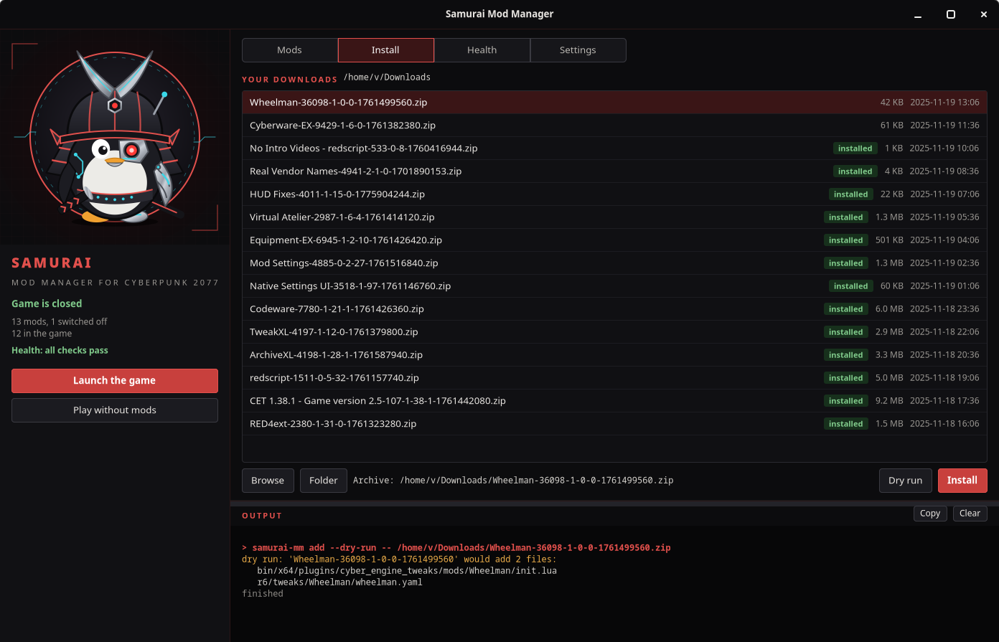
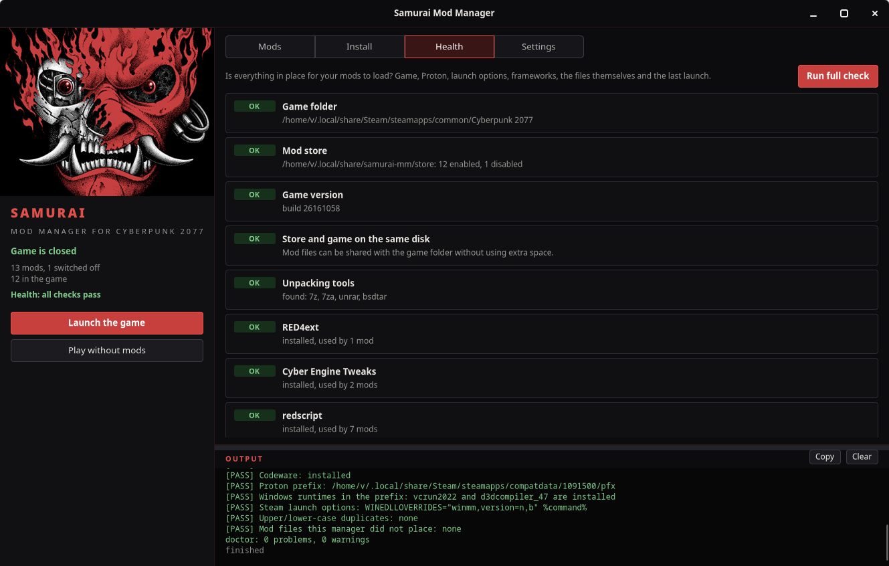

# Samurai Mod Manager

A mod installer and manager for **Cyberpunk 2077 on Linux** (Steam with Proton, also Heroic
and Lutris). Made and tested with game version 2.5.


Vortex has no Linux release, and copying mod files in by hand goes wrong on Linux in ways it
does not on Windows. Samurai Mod Manager does the copying for you and keeps track of every
file, so any mod, or all of them, can be taken out again cleanly.

**Status: 0.9.0 beta.** Built and used daily on CachyOS (Arch). It has not yet been tried on
many other setups, so reports from other distributions are welcome. A Windows version is
planned later.

This is an unofficial fan project. It is not made, approved or supported by CD PROJEKT RED or
Nexus Mods. It never connects to the internet and collects nothing.

## What it does

- **Installs** zip, 7z and rar downloads, or an unpacked folder. It works out where the files
  go, and a dry run shows the plan first.
- **Asks instead of guessing.** Downloads with several variants, or with a FOMOD installer,
  open a chooser where you tick what you want.
- **Switches mods on and off** without deleting them.
- **Updates.** A newer download of a mod you have is recognised and replaces the old version.
- **Never overwrites** another mod's files or the game's own files.
- **Removes cleanly.** Every placed file is recorded. One button takes all mods out for a
  vanilla session and puts them back afterwards.
- **Handles upper and lower case.** Windows treats `R6/Scripts` and `r6/scripts` as one folder;
  Linux does not. Files are merged into whatever folders already exist.
- **Health check for the Linux side.** The frameworks your mods need (RED4ext, Cyber Engine
  Tweaks, redscript, ArchiveXL, TweakXL, Codeware), the Proton prefix runtimes, the Steam launch
  options, game updates and stray files, each with the exact fix.
- **Careful with downloads.** Archives are inspected before unpacking; anything built to write
  outside its own folder is refused.
- Refuses to change anything while the game is running.

| Install tab | Health tab |
| --- | --- |
|  |  |

## Install

1. Download the latest version and unpack it (from the Files tab on Nexus Mods, or the green
   **Code** button here, **Download ZIP**).
2. Open a terminal in the unpacked folder and run:

```bash
sh install.sh
```

That is all. The installer checks for the three things the manager needs (Python, GTK 4 and
7-Zip). If one is missing it shows the exact command for your distribution and offers to run
it for you. Then it installs the manager for your user only: no root, nothing system-wide.
You can delete the unpacked folder afterwards.

- **Open it:** "Samurai Mod Manager" in your app menu, or `samurai-mm-gui`.
- **Update it:** download the new version and run `sh install.sh` again. Your mods and settings stay.
- **Remove it:** `sh ~/.local/share/samurai-mm/app/install.sh --remove`. Your mods and settings stay.

<details>
<summary>Installing the needed packages by hand</summary>

You need Python 3.10+, GTK 4.12+ with PyGObject, and 7-Zip (plus `unrar` for some rar files).

| Distribution | Command |
| --- | --- |
| Arch, CachyOS, EndeavourOS, Manjaro | `sudo pacman -S --needed python gtk4 python-gobject 7zip unrar` |
| Fedora, Nobara | `sudo dnf install python3 gtk4 python3-gobject p7zip p7zip-plugins` |
| Ubuntu 24.04+, Mint 22+, Pop!_OS | `sudo apt install python3 python3-gi gir1.2-gtk-4.0 7zip` |
| openSUSE | `sudo zypper install python3 python3-gobject typelib-1_0-Gtk-4_0 7zip` |

Ubuntu 22.04 and Debian 12 ship a GTK that is too old for the window; the command line still works there.
</details>

Steam Deck: SteamOS does not let you install these packages the normal way, so the window is
untested there.

If you cloned this repository and want to run it straight from the clone (and update with
`git pull`), use `sh install.sh --in-place`.

## Use

Open **Samurai Mod Manager** from the app menu. On first start it shows the game folder it
found, where your mods will be kept and your downloads folder, and lets you change each before
anything is created.

1. On a mod's Nexus page choose **Manual download**.
2. On the **Install** tab pick it from your downloads, press **Dry run**, then **Install**.
3. Look at the **Health** tab. It tells you if a framework, a Proton runtime or a launch option
   is missing, with the exact fix.

After a game update the manager stops placing files, because the frameworks are tied to the
game version. Install the updated frameworks, then accept the new version on the Health tab.

### Command line

Everything the window does, and a few rarer options, is available as `samurai-mm`:

```bash
samurai-mm add ~/Downloads/"Some Mod-1234-1-0-1700000000.zip" --dry-run
samurai-mm add ~/Downloads/"Some Mod-1234-1-0-1700000000.zip"
samurai-mm list
samurai-mm disable "some mod"        # a unique part of the name is enough
samurai-mm enable "some mod"
samurai-mm remove "some mod"
samurai-mm doctor                    # the health check
samurai-mm undeploy                  # all mods out; `deploy` puts them back
samurai-mm --help
```

## Good to know

- Your mods, the list of what is installed and every backup live in one folder, the mod store
  (default `~/.local/share/samurai-mm/store`). Back it up and you can rebuild everything.
- A removed mod is kept in `removed/` inside the store. Nothing is deleted outright.
- When store and game are on the same disk (btrfs or XFS), mod files take no extra space.
- Mods are programs and data made by strangers. The manager never runs anything from a
  download, but it cannot tell you whether a mod is trustworthy once the game loads it.
  Download from sources you trust.

## Not there yet

- Two mods that ship the same file: the second is refused rather than layered on top, so there
  is no load order yet.
- Update checks and the "Mod manager download" button on Nexus. A button opens the mod's page.
- FOMOD installers with unusual conditions fall back to ticking folders by hand.
- REDmod (`mods/` folder) mods are installed but not deployed through REDmod.
- Profiles, packages for the AUR or Flatpak, languages other than English.

## Problems and ideas

The **Health** tab names the problem and the fix in most cases, and **Play without mods**
always gets you back to a vanilla game. If something is still wrong, open an issue here and
include the text of the output pane (it has a Copy button).

## License

Copyright (c) 2026 ptm4. All rights reserved. Samurai Mod Manager is free to download and use.
You may read the source and change your own copy, but you may not redistribute it, re-upload
it, or publish modified versions without permission. The full terms are in [LICENSE](LICENSE).
Suggestions and fixes are welcome.

## Artwork

The Samurai picture and the icon made from it come from Cyberpunk 2077 and belong to
CD PROJEKT S.A. They are included as non-commercial fan content so the manager is easy to
recognise. They are **not** covered by this project's license. If CD PROJEKT RED asks for them
to be removed, they will be.
