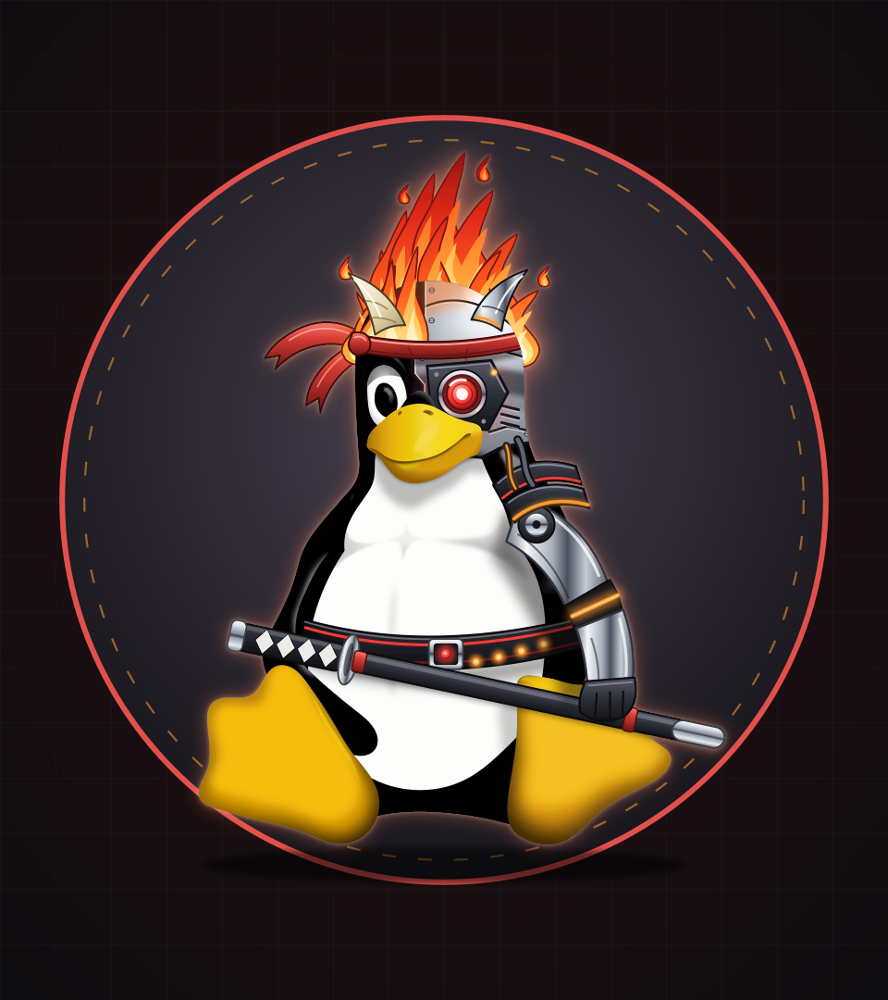
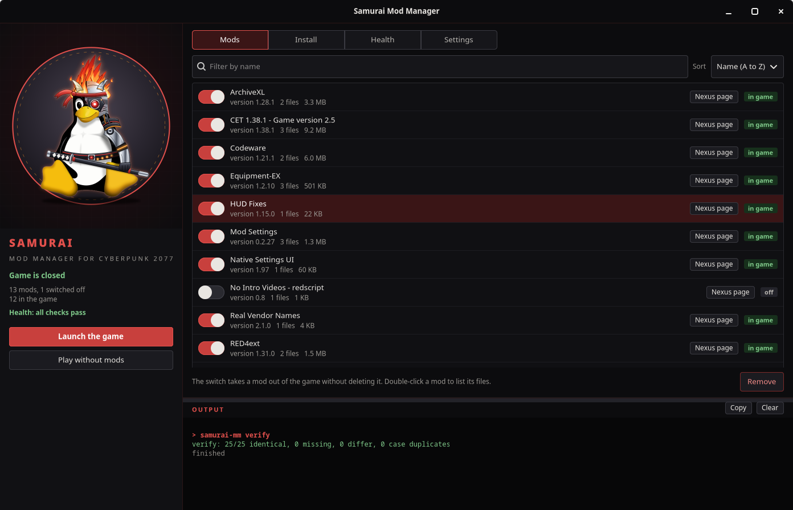

<p align="center"></p>

# Samurai Mod Manager

Free and open source (GPL-3.0). A mod installer and manager for **Cyberpunk 2077 on Linux** (Steam with Proton, also Heroic
and Lutris). Made and tested with game version 2.5.



Vortex has no Linux release, and copying mod files in by hand goes wrong on Linux in ways it
does not on Windows. Samurai Mod Manager does the copying for you and keeps track of every
file, so any mod, or all of them, can be taken out again cleanly.

**Status: 0.9.0 beta.** Built and used daily on CachyOS (Arch). It has not yet been tried on
many other setups, so reports from other distributions are welcome. A Windows version is
planned later.

It never connects to the internet and collects nothing. Contributions are welcome: see
[CONTRIBUTING.md](CONTRIBUTING.md).

This is an unofficial fan project. It is not made, approved or supported by CD PROJEKT RED or
Nexus Mods. Cyberpunk 2077 is a trademark of CD PROJEKT S.A.

## What it does

- **Installs** zip, 7z and rar downloads, or an unpacked folder. It works out where the files
  go, and a dry run shows the plan first.
- **Asks instead of guessing.** Downloads with several variants, or with a FOMOD installer,
  open a chooser where you tick what you want.
- **Switches mods on and off** without deleting them.
- **Sorts the list** by name, most recently installed, or biggest.
- **Updates.** A newer download of a mod you have is recognised and replaces the old version.
- **Never overwrites** another mod's files or the game's own files.
- **Removes cleanly.** Every placed file is recorded. One button takes all mods out for a
  vanilla session and puts them back afterwards.
- **Handles upper and lower case.** Windows treats `R6/Scripts` and `r6/scripts` as one folder;
  Linux does not. Files are merged into whatever folders already exist.
- **Health check that walks you through the Linux side.** The frameworks your mods need (RED4ext,
  Cyber Engine Tweaks, redscript, ArchiveXL, TweakXL, Codeware), the Windows runtimes in the Proton
  prefix, the Steam launch options, game updates and stray files. Anything missing comes with
  numbered steps and buttons: open the right download page, install the download, install the
  runtimes, copy the launch options and open the game's properties in Steam.
- **Careful with downloads.** Archives are inspected before unpacking; anything built to write
  outside its own folder is refused.
- Refuses to change anything while the game is running.

| Install tab | Health tab |
| --- | --- |
|  |  |

## Install

1. Download the latest version and unpack it (from the Files tab on Nexus Mods, or the green
   **Code** button here, **Download ZIP**).
2. Open a terminal in the unpacked folder and run:

```bash
sh install.sh
```

That is all. The installer checks for the three things the manager needs (Python, GTK 4 and
7-Zip). If one is missing it shows the exact command for your distribution and offers to run
it for you. Then it installs the manager for your user only: no root, nothing system-wide.
You can delete the unpacked folder afterwards.

- **Open it:** "Samurai Mod Manager" in your app menu, or `samurai-mm-gui`.
- **Update it:** download the new version and run `sh install.sh` again. Your mods and settings stay.
- **Remove it:** `sh ~/.local/share/samurai-mm/app/install.sh --remove`. Your mods and settings stay.

<details>
<summary>Installing the needed packages by hand</summary>

You need Python 3.10+, GTK 4.12+ with PyGObject, and 7-Zip (plus `unrar` for some rar files).

| Distribution | Command |
| --- | --- |
| Arch, CachyOS, EndeavourOS, Manjaro | `sudo pacman -S --needed python gtk4 python-gobject 7zip unrar` |
| Fedora, Nobara | `sudo dnf install python3 gtk4 python3-gobject p7zip p7zip-plugins` |
| Ubuntu 24.04+, Mint 22+, Pop!_OS | `sudo apt install python3 python3-gi gir1.2-gtk-4.0 7zip` |
| openSUSE | `sudo zypper install python3 python3-gobject typelib-1_0-Gtk-4_0 7zip` |

Ubuntu 22.04 and Debian 12 ship a GTK that is too old for the window; the command line still works there.
</details>

Steam Deck: SteamOS does not let you install these packages the normal way, so the window is
untested there.

If you cloned this repository and want to run it straight from the clone (and update with
`git pull`), use `sh install.sh --in-place`.

## Use

Open **Samurai Mod Manager** from the app menu. On first start it shows the game folder it
found, where your mods will be kept and your downloads folder, and lets you change each before
anything is created.

1. On a mod's Nexus page choose **Manual download**.
2. On the **Install** tab pick it from your downloads, press **Dry run**, then **Install**.
3. Look at the **Health** tab. If a framework, a Proton runtime or a launch option is missing, it
   lists the steps and does what it can for you with one click each.

After a game update the manager stops placing files, because the frameworks are tied to the
game version. Install the updated frameworks, then accept the new version on the Health tab.

### Command line

Everything the window does, and a few rarer options, is available as `samurai-mm`:

```bash
samurai-mm add ~/Downloads/"Some Mod-1234-1-0-1700000000.zip" --dry-run
samurai-mm add ~/Downloads/"Some Mod-1234-1-0-1700000000.zip"
samurai-mm list
samurai-mm disable "some mod"        # a unique part of the name is enough
samurai-mm enable "some mod"
samurai-mm remove "some mod"
samurai-mm doctor                    # the health check, with the steps to fix what it finds
samurai-mm runtimes                  # install the Windows runtimes the mod loaders need
samurai-mm undeploy                  # all mods out; `deploy` puts them back
samurai-mm --help
```

## Good to know

- Your mods, the list of what is installed and every backup live in one folder, the mod store
  (default `~/.local/share/samurai-mm/store`). Back it up and you can rebuild everything.
- A removed mod is kept in `removed/` inside the store. Nothing is deleted outright.
- When store and game are on the same disk (btrfs or XFS), mod files take no extra space.
- Mods are programs and data made by strangers. The manager never runs anything from a
  download, but it cannot tell you whether a mod is trustworthy once the game loads it.
  Download from sources you trust.

## Not there yet

- Two mods that ship the same file: the second is refused rather than layered on top, so there
  is no load order yet.
- Update checks and the "Mod manager download" button on Nexus. A button opens the mod's page.
- FOMOD installers with unusual conditions fall back to ticking folders by hand.
- REDmod (`mods/` folder) mods are installed but not deployed through REDmod.
- Profiles, packages for the AUR or Flatpak, languages other than English.

## Problems, ideas and contributing

The **Health** tab names the problem and the fix in most cases, and **Play without mods**
always gets you back to a vanilla game. If something is still wrong, open an issue here and
include your distribution and the text of the output pane (it has a Copy button).

Pull requests are welcome. Every change is reviewed and merged by the maintainer,
[@ptm4](https://github.com/ptm4). Read [CONTRIBUTING.md](CONTRIBUTING.md) first: it explains
what fits the project, how to run the tests, and the `git commit -s` sign-off every commit needs.

## License

Samurai Mod Manager is free software: you can use it, study it, change it and share it under the
terms of the [GNU General Public License, version 3 or later](LICENSE). If you share a changed
version, it must stay under the same license with its source available.

It comes with **no warranty**. It changes files in your game folder; keep a backup of anything
you cannot download again.

Copyright (C) 2026 ptm4 and Samurai Mod Manager contributors.

## Name and logo

"Samurai Mod Manager" and its logo identify the official project maintained by
[@ptm4](https://github.com/ptm4). The GPL covers the code, not the name: if you publish a fork,
please give it a different name and logo so people can tell the two apart. Packaging the official
version unchanged for a distribution is fine under its own name.

The mascot is Tux, the Linux penguin, as a cyber samurai: half machine, with horns, a red headband and fire
rising from his head. Tux was created by Larry Ewing
(lewing@isc.tamu.edu) with The GIMP; the vector version used here was re-illustrated by Garrett LeSage and
refined by IFo Hancroft, and comes from the Linux kernel sources. It is freely usable as long as they are
credited. Everything drawn over him (fire, headband, horns, armour, cyberware) is original artwork covered by this project's
license; Tux himself stays under his creators' terms. The fiery, half-machine head is a nod to the band
Samurai from Cyberpunk 2077, drawn from scratch. The sources are in `dev/artwork/`.

The project contains no art or other assets from Cyberpunk 2077.
